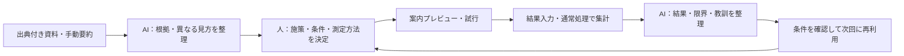

# MIURA LOOP：評価・勝ち筋・実行計画

作成日：2026-10-29  
対象：[new_idea.md](new_idea.md) の具体化案  
判断材料：[募集要項](problem.md)、[既存ヒアリング](hearing.md)、[既存調査](plan.md)、公開一次資料・公開口コミ  
実行条件：**11月20日提出／3人チーム／実装担当は1人／追加の現地ヒアリングは不可**

本書の施策・機能・目標値は提案であり、チームの決定や実証済みの成果ではない。外部情報の確認日は2026年10月29日。勝率や順位は、他チームの提案・審査配点が不明なため算定しない。

## 1. 推奨する方向

**MIURA LOOPの思想は残す。ただし、最初の製品を「三浦の小さな観光施策を、根拠の確認から実施準備・検証・次回への改善までつなぐAI」に絞る。**

最初の題材は、**三崎での「昼食後のもう一軒・もう60分」**。これは効果が確かめられた施策ではなく、既存ヒアリングと公開情報から選ぶ最初の検証候補である。

審査での説明は、次の順序にする。

1. 三浦市が重視する滞在・消費の課題を示す。
2. 公開情報から、課題を裏付ける声と、別の見方を示す声を確認する。
3. 担当者が選んだ施策を、対象者・実施条件・案内物・測定方法まで具体化する。
4. 試行結果を記録し、「何が分かったか／まだ分からないか」を整理する。
5. 次の検討で、過去の教訓と適用条件を呼び出す。

**11月20日までに示す成果は、使えるアプリ、根拠のある課題整理、AI品質の評価、作業比較の結果。地域での売上増・滞在延長は導入後に検証する。**

追加ヒアリングができない以上、「市の業務で本当に必要とされるか」は大きな未検証事項として残る。その弱点は、公開資料だけで解消したことにしない。

### 企画の一文

> MIURA LOOPは、地域の声と過去の検証記録を根拠に、三浦の小さな観光施策を実施・評価し、次の改善へつなげるAI Webアプリです。まず、昼食後の追加周遊・消費を増やす取り組みから始めます。

元案の「人間が決め、AIが情報整理・検証・引き継ぎを支える」という方針は維持する。

## 2. 現案の評価

### 審査基準との関係

点数は公式配点や実測を装うため使わず、現状の強弱と、提出までに必要な証拠を整理する。

| 評価軸 | 現案の評価 | 評価理由 | 補強に必要なもの |
| --- | --- | --- | --- |
| アイデアの妥当性 | 条件付き | 改善の継続は大切だが、滞在・消費までの間に複数の段階がある | 誰が何を実施し、旅行者のどの行動が変わるかを1事例で示す |
| 実用性・価値 | 最大の不確実性 | 利用者、日常業務の困りごと、運営主体、入力負担、支払者が未確認 | 最小の運用設計、作業比較、導入後の実証計画 |
| 独創性 | 現状の説明では弱い | 行政向けAI・データ分析・PDCA支援には既存の取り組みがある | 実施条件と検証結果が、次の施策判断に再利用される動作 |
| AI活用の深度 | 設計次第 | 要約と文章生成だけだと汎用AIとの差が小さい | 根拠の対応付け、反対の声の提示、条件に合う教訓の検索を評価する |
| 使いやすさ | 未評価 | 自由度の高い課題管理は、何から始めるか分かりにくくなりやすい | 最初から1件の施策を開ける体験と、少ない入力項目 |
| 完成度 | 未評価 | 構想の広さに対して実装は1人 | 一連の操作を早期に完成し、途中保存・再読込・AI失敗時まで確認する |

### 残すべき強み

- 成功だけでなく、失敗・未確認点・実施条件が地域に残る。
- 既存施策を対象にでき、新たな大型施設やイベントを必須としない。
- 観光協会などの担当者が代わっても、判断の根拠を引き継げる構造を作れる。
- 観光客全員へのアプリ普及を、運用開始の前提にしなくてよい。
- 対象を一つに絞っても、長期の改善基盤という思想が残る。

いずれも期待する価値であり、三浦での導入効果が確認できたわけではない。

### 最も危険な前提

| 前提 | 現時点の扱い |
| --- | --- |
| 市では施策の評価や引き継ぎができていない | 未確認。断定しない |
| 口コミを読むと、事業者の業務上の負担まで分かる | 分からない。旅行者の体験と、内部業務を分ける |
| ノウハウを蓄積すれば、自然に売上が増える | 未検証。実施・接点・行動・購入をつなぐ必要がある |
| 行政向けなので観光案内アプリより独創的 | 成り立たない。実際の既存サービスと比較する |
| AI補助があれば機能を増やしても完成できる | データの正確性、評価、説明、修正には人の時間が必要 |

特に「市にPDCAがない」という説明は避ける。2021年の市の観光振興ビジョンには官民連携とKPI評価・PDCAの方針が明記されている。本案は、その方針を小規模な試行にどう接続するかを提案するものと位置付ける。この資料が現在の業務実態や最新計画をそのまま表すとはみなさない。[三浦市観光振興ビジョン・冊子27ページ](https://www.city.miura.kanagawa.jp/material/files/group/27/kankoushinnkouvision.pdf)

## 3. 公開情報から確認できたこと

### 既存サービスとの重なり

| 比較先 | 公開資料で確認できた範囲 | 本案への示唆 |
| --- | --- | --- |
| 日本観光振興協会「デジプラ」 | 観光データとAIを使った分析レポート・観光振興計画等の策定支援を2026年2月に発表 | 「データからAIが課題を分析する」だけでは差が弱い |
| 観光DMP | データ統合、施策の効果可視化、PDCA支援を掲げる製品がある | 「可視化から改善へ」だけでも独自性は主張しにくい |
| 京急newcal | 2024年の公式発表に地域共通予約、決済、デジタルチケット、経路検索、地域情報発信の記載 | 予約・販売・総合観光案内の再実装は優先しない |
| 三崎マグロ茜身スタンプラリー2026 | QR・GPSによる周遊、地図、賞品応募を既に提供 | QRやスタンプ自体を革新性の根拠にしない |

根拠：[デジプラの2026年2月発表](https://nihon-kankou.or.jp/home/userfiles/files/autoupload/2026/02/1770956997.pdf)、[Vpon公式の観光DMP説明](https://www.vpon.com/jp/solutions/tourism-dmp/)、[京急のnewcal公式発表](https://www.keikyu.co.jp/company/news/2023/20240314HP_23129YM.html)、[茜身ラリー公式](https://chiai-knowledge.com/stamprally/)。

これらの全機能・操作・料金・API接続可否は調べ切っていない。「競合には実施管理や学習機能がない」とは断定しない。**本案の差別化は、実際に作る業務の流れと比較評価で示す。**

なお、宿泊ときっぷをつなぐ施策も既に存在する。京急は2026年8月に「地域まるごとホテル＠三浦半島」とデジタルきっぷの連携施策を発表している。宿・食・交通をつなぐという大枠も、それだけで新規性にはならない。[京急公式発表](https://www.keikyu.co.jp/company/news/2026/20260827HP_26061TE.html)

### 口コミの初期確認

以下は今回確認した投稿の要約。投稿の存在を確認したもので、内容の客観的正確性、問題の頻度、市全体の傾向を保証するものではない。探索時の検索条件にも偏りがあり、全件調査ではない。

| ID | 出典・時期 | 投稿の要点（要約） | 示唆と限界 |
| --- | --- | --- | --- |
| R01 | じゃらん・三崎港、2026-03-10投稿 | 食事の後の街歩きを楽しみ、移動も便利と感じた体験 | 既に食後の散策が成立している人がいる。一律に案内不足と扱わない |
| R02 | 同一覧、2025-09-24投稿 | うらりで、マグロ以外の品ぞろえ・見どころに物足りなさを感じた体験 | 選択肢の伝わり方を調べる材料。ただし、知らなかったのか好みに合わなかったのかは不明 |
| R03 | じゃらん・三崎宿、2026-09-11投稿 | 近隣の店での食事や持ち帰りも含めて滞在を楽しんだ体験 | 泊食分離の成功例。飲食の供給が全くないという説明を否定する |
| R04 | 同一覧、2026-09-02投稿 | 街歩きを楽しみ、夕食・朝食にも困らなかった体験 | 朝食の課題が全宿泊客に共通するとはいえない |
| R05 | Yahoo!マップ・三崎港、2023-05-09投稿 | 駅からの距離や混んだバスを負担に感じた体験 | 移動負担の仮説。古い一投稿で現在の混雑を決めない |

出典：[R01の個別投稿](https://www.jalan.net/kankou/spt_guide000000186722/kuchikomi/0005845875/)、[R02を確認した三崎港口コミ一覧](https://www.jalan.net/kankou/spt_guide000000186722/kuchikomi/)、[R03・R04を確認した三崎宿口コミ一覧](https://www.jalan.net/yad373616/kuchikomi/)、[R05を確認したYahoo!マップ](https://map.yahoo.co.jp/v3/place/IGSj9a9KDWg)。一覧ページは更新されるため、アプリに使う場合は投稿年月日・タイトル・確認日も記録する。

ここから設定できる仮説は、**「既に楽しめている人と、次の選択肢に魅力を感じない人の違いを調べ、条件に合った接点を作れば、一部の旅行者の追加周遊につながるかもしれない」**までである。

### 調査データを作る方法

非実装の2人は、次の分担で公開情報を整理する。件数は収集目安であり、需要の大きさを推定する統計標本ではない。

- 調査担当：市・県・観光協会・運営者の資料を10〜15件。既存施策、利用条件、更新日、実施主体を整理する。
- 評価・資料担当：公開口コミを合計30件程度。三崎港周辺、街歩き・買い物、宿泊・食の3群を目安に、好評・不満・中立を記録する。
- 同じ投稿の転載・宿側の返信を別の旅行者の声として重複計上しない。
- 同名の「三崎港」が別地域にもあるため、神奈川県三浦市の情報か確認する。
- 営業時間・価格・休業は口コミで確定せず、運営者の公式情報を優先する。
- 不満語だけの検索で抽出した場合は、その検索条件を残す。「何％が困っている」と一般化しない。
- 原文・写真の大量転載を前提にせず、出典付きの短い手動要約を基本にする。サービスごとの利用条件を確認して扱う。

記録項目：ID／URL／資料名または投稿タイトル／公開日・訪問時期／確認日／地域／内容種別／短い要約／裏付ける仮説／別の解釈／現在性の限界。

## 4. 提供価値と最初の利用者

### 利用者を一段絞る

最初の主利用者候補は、**観光協会などで、小規模な周遊施策の調整をする担当者1人**とする。三浦市全職員や全事業者が毎日ログインする設計にしない。

| 関係者 | してもらうこと | 得られる価値の仮説 |
| --- | --- | --- |
| 調整担当者 | 根拠確認、施策の決定、条件確認、結果の振り返り | 資料探し・確認・報告の重複を減らし、次の判断に使える記録を残す |
| 参加店 | 案内可否・営業時間等の確認、可能な範囲で実績記録 | 受け入れられる時間帯に、条件の合う来店機会を得る |
| 市の担当者 | 実施判断や成果・負担の確認 | 継続・修正・中止の理由を確認できる |
| 旅行者 | 必要なときだけ短い案内を見る | 残り時間や移動条件に合う寄り道を選べる |

組織の参加・運営受託・費用負担の合意は得ていない。上表は導入後の役割案。

### 一番伝えたい固有の価値

> 「前に何をしたか」に加え、「どんな条件で、何を測り、何が分かり、次にどう使えるか」が残る。

学習記録は最低限、次を持つ。

- 対象者・地域・時間帯・季節・天候。
- 実施した変更と、比較対象。
- 指標の定義、分母・分子、計測方法、欠測。
- 観測できた結果と、推測・未確認事項。
- 実施・入力にかかった負担。
- 次回使える条件、使えない条件、再確認が必要な情報。
- 根拠となる資料・実施記録へのリンク。

Notionや汎用AIでも構築できる部分はある。差は「実現不可能な機能」より、**観光施策に必要な確認と記録が、一連の操作で揃うこと、その作業が速く正確にできること**で示す。

### コア機能の具体例：似た施策を、そのまま流用しない

次は全て架空の検証記録を使うデモ例。

- 記録D01：晴天、休日、残り60分の来訪組に街歩き案内。配布80組、購入確認12組。比較群はない。
- 記録D02：雨天、平日、同じ案内。配布70組、購入確認2組。比較群はない。
- 今回：雨天、残り30分、徒歩移動を短くしたい旅行者を対象に検討する。

このときAIには「晴れなら成功、雨なら失敗」と結論させない。地域・曜日・対象・記録条件も違い、比較群がないからである。代わりに、次を元記録付きで示す。

1. 参考になるのは、案内接点や記録方法など、今回と共通する部分。
2. 60分の街歩きは、今回の30分という条件に適合しない。
3. 購入確認率の差を、天候の因果効果とみなすことはできない。
4. 今回は徒歩時間の短い候補を確認し、通常案内との比較方法を先に決める必要がある。

人が案内方針を変更すると、施策カードと測定計画に反映される。**蓄積した記録を検索できることに加えて、誤った流用を減らし、今回の判断を具体的に進められること**を価値にする。

## 5. 最初の具体施策：「昼食後のもう一軒・もう60分」

### この題材を先にする理由

| 候補 | 観光消費との接続 | 実施上の依存 | 今回の扱い |
| --- | --- | --- | --- |
| 昼食後の徒歩圏への案内 | 追加の喫茶・買い物につながる可能性 | 対象店・掲載情報・案内接点の確認 | **主題材**。既存資源で案内・測定の試作品を作りやすい |
| 素泊まり客への翌朝案内 | 泊食分離の質・翌朝の滞在と接続 | 宿との接点、朝営業の確認 | 次の題材。宿泊増への直接効果は別途検証 |
| 団体向け体験の個人客募集 | 有料体験・滞在と接続 | 催行人数、予約、決済、キャンセル調整 | 将来候補。今回の実装から外す |
| 夜間営業・イベントの新設 | 夜までの滞在と接続 | 人員、需要、移動、開催負担 | 今回は対象を広げない |

これは公開情報と開発条件からの選択。需要の強さが実証された順位ではない。

### 実施仕様案

| 項目 | 具体案 |
| --- | --- |
| 対象地域 | 三崎港・三崎下町の徒歩圏。最初は地域間交通を増やさない |
| 対象旅行者 | 昼食後、30〜90分程度の余裕があり、次の予定が固定していない組 |
| 変えたい行動 | 昼食後、希望に合う1〜2か所へ立ち寄り、可能なら喫茶・買い物等をする |
| 接点 | 導入後は協力飲食店の会計時または案内所。アプリの事前インストールは不要 |
| 提供内容 | 「30分の買い物」「60分の街歩き＋休憩」など、確認済み候補から選ぶ短い案内 |
| 旅行者の入力 | 残り時間、買い物／休憩等の希望、歩行の制約。自由記述は任意 |
| 案内に必要な情報 | 所要時間の目安、移動、料金の目安、営業時間、確認日、利用条件、公式リンク |
| 初期の規模 | 入口2か所・受入先3〜5か所を想定。協力は未獲得 |
| 調整担当者の役割 | 情報と受入条件を確認し、掲載内容・実施可否を決める |
| 参加店の負担目標 | 案内は一言、記録は1件数十秒程度を目標に設計。実測して採否を決める |
| まず変えること | 既存案内に「残り時間内で何ができるか」を付ける。値引きや新商品の造成は初期条件にしない |
| 中止・修正の条件 | 情報更新が追い付かない、受入負担が便益を上回る、購入・立寄りの確認ができない場合 |

**「60分」は案内メニューの目安で、滞在が60分延びるという効果の主張ではない。**

県は三崎下町を商店・食・街並みの観光資源として案内している。一方で、個々の店舗の現在の受入余力は公開情報だけでは分からない。[神奈川県・三崎の見どころ](https://www.pref.kanagawa.jp/docs/d2t/chiki/misakiosusume.html)

### 例として作る案内

> 昼食のあと、港町でひと休み。  
> 残り60分なら、徒歩圏の街歩きと喫茶を組み合わせられます。  
> 候補ごとに所要時間、予算の目安、営業情報の確認日を表示。合う候補がなければ、その理由を表示します。

実装では、運営者情報を確認した5〜8スポット程度を登録する。実在する店に、未確認の体験商品・割引・予約枠を付けない。架空の店や条件を使う場合はサンプルと表示する。

### 施策の因果関係

案内を見た → 自分に合う選択肢を見つけた → 立ち寄った → 購入した → 市内での滞在・消費が増えた。

この各段階は同じものではない。「閲覧が増えた」だけで地域売上増とはいわない。来店しても、元から予定していた購入の置き換えかもしれない。最後まで測れない段階では、観測できた範囲を成果として報告する。

### 次の2施策

**施策B：素泊まり客への翌朝案内。** 宿泊予約後・チェックイン時に、翌朝利用できる既存の朝食・買い物・散策を案内する。指標は案内後の利用確認と満足・不便、情報更新の負担。朝食提供店が少ないという既存ヒアリングと、食事に困らなかった口コミの両方を材料にする。案内だけで解けるのか、供給不足なのかを分ける。初期から新しい朝食提供や予約保証は約束しない。

**施策C：既存ラリーの案内改善。** ラリー運営者の協力が得られた段階で、どこで参加・回遊が止まるかを確認し、対象条件を絞って案内を変更する。新しいラリーを作ることは必須にしない。公開情報だけでは参加者数・離脱箇所・売上を把握できないため、現時点で改善効果は主張しない。

B・Cは拡張可能性を示す補助事例にとどめ、11月20日までの開発は主題材で揃える。

## 6. MVP：実装1人で完成させる範囲

### 最初から最後まで通す5機能

| 優先度 | 機能 | 具体的な動作 | 完成とみなす条件 |
| --- | --- | --- | --- |
| P0 | 根拠を整理する | テキスト・手動要約に出典を付け、事実／意見／仮説を確認・保存 | AIの各主張から資料IDを開ける。反対の材料も確認できる |
| P0 | 施策カードを作る | 人が決めた対象・施策を、条件・担当・指標・未確認事項に整理 | 分母・計測方法が空なら未完成と分かる。保存して再編集できる |
| P0 | 短い案内を試す | 確認済みスポットから、残り時間等に合う候補を表示 | 条件不適合の候補を除外し、候補ゼロも処理できる |
| P0 | 結果と限界を整理する | 件数・金額・欠測・現場メモを入力し、通常処理で集計、AIで解説 | 数値が一致する。比較対象なしでは「効果不明」と扱う |
| P0 | 教訓を次回に使う | 過去の記録から、今回に関係する教訓と条件の違いを提示 | 条件を変えると適用可否・再確認事項が変わる |

画面は、管理側2画面＋旅行者向け1画面を基本とする。

1. **施策一覧**：最初から主題材を表示。「今回の施策を開く」が主操作。
2. **施策詳細**：根拠／実施準備／結果・教訓を切り替える。出典確認は共通のサイド表示。
3. **案内プレビュー**：スマートフォンでも使える短い候補表示。導入前のデモであることを表示。

紹介コードの記録は施策詳細内の簡単なフォームでよい。店舗専用アプリ・予約管理・決済を別途作らない。

### 今回は外す機能

- あらゆる観光課題を自由に処理する総合システム。
- 自治体全体の会議・稟議・複雑なタスク管理。
- 独自の交通・混雑予測やリアルタイム在庫。
- 自動巡回による口コミの大量収集。
- 決済、予約確定、LINE等への自動送信。
- 音声入力、動画生成、多言語の同時対応。
- 制限付き人流データを外部アプリに取り込む機能。
- 複数自治体への横展開を実装すること。

余力があればP1として、印刷用の施策シートと報告書出力を追加する。新機能より根拠の修正・操作の安定を優先する。

## 7. AIの仕事と実装方針

### AIを使う3か所

**1. 散らばる情報から、根拠と食い違いを整理する。**

入力は、出典ID付きの短い資料断片と手動要約。出力は「主張／資料ID／事実・意見・仮説／対象条件／別の見方／不足情報」。口コミの感想を行政の内部事情に変換しない。ユーザーが確認して採用する。

**2. 今回の条件で使える過去の教訓を探す。**

「食後の回遊」などの意味の近さに加え、地域・時間帯・移動・天候・受入条件を比較する。「参考になる点」と「今回は使えない点」を分ける。実績がない段階の教訓は、例示データであることを常に表示する。

**3. 計算済みの結果を、限界付きの報告に整理する。**

件数・率・合計は通常のプログラムで計算する。AIはその値を使い、観測事実、考えられる解釈、追加確認、次の検証の選択肢を整理する。次の施策の採否は人が決める。

### AIに任せない処理

- 営業時間、料金、予約枠、実測値の創作。
- 数値の集計・率の算出・日時の判定。
- 閉店時間や歩行時間等の明確な条件判定。
- 権限の判断、公開承認、施策の実施決定。
- 少数の前後比較からの因果効果の断定。
- 情報がない状態での成功率・売上予測の生成。

### 最小のデータ構造

| データ | 最低限の項目 |
| --- | --- |
| Source | ID、URL等、公開・非公開区分、公開日、確認日、地域、要約、情報種別 |
| Claim | 主張、Source ID、事実・意見・仮説、条件、確認状態 |
| Spot | 場所、公式出典、営業時間、利用条件、所要時間・費用の目安、確認日 |
| Experiment | 目的、仮説、対象、変更、条件、担当、期間、比較方法、指標定義、実施状態 |
| Result | Experiment ID、群、分母・分子、件数・金額、欠測、計測方法、メモ、実測・模擬区分 |
| Learning | Experiment ID、結論、限界、適用条件、再確認事項、根拠、版 |

資料・口コミ・実測・模擬は型で区別し、画面の色だけに依存しない。

### 構成

慣れているWeb構成を使い、サーバー側のAI呼び出しと小さなデータベースで始める。最初の数十件なら、全文検索・タグ・条件フィルタとAIによる説明で足りるか先に確かめる。専用ベクトルDB、複数AIエージェント、追加学習を初期条件にしない。

AI出力は決めた形式で受け取り、存在しない出典IDを拒否する。根拠との内容一致は別途評価する。IDが存在するだけで正しい引用とはしない。

資料は分析対象として扱い、資料中の「これを実行せよ」という文をアプリへの指示として扱わない。承認前の内容を公開案内へ自動反映しない。

AI呼び出しの失敗時は、入力と保存済みの内容を保持して再試行できるようにする。保存済みの生成例を見せる場合は「過去に生成した例」と明示し、ライブ実行と区別する。

審査用はセッションごとに編集領域を分け、初期状態に戻せるようにする。実際のAI生成はソースコードと操作で確認できるようにし、審査期間中の利用制限・費用上限も確認する。

## 8. データの使い方

### 提出時に用意する最小セット

- 出典付きの公開資料・手動要約：20〜40レコード程度。
- 案内に使う確認済みスポット：5〜8件。
- 実施前の施策カード：主題材1件。
- 過去の検証例：成功らしい例・不調な例・データ不足の例の3件。**全て模擬と表示**。
- 評価用の未見ケース：20件程度。開発時の例と分ける。

過去の検証例をAIに作らせても、三浦で実際に起きた出来事として扱わない。模擬データがあることと、地域に検証実績が蓄積されたことは別である。

### 人流データの扱い

募集要項では、提供データは2025年8月と2026年8月の125mメッシュ集計で、ダウンロード禁止と記載されている。既存ヒアリングでは活用必須ではない。[募集要項](problem.md)、[既存ヒアリング](hearing.md)

今回のMVPは、このデータを使わなくても成立する設計にする。使用するなら指定環境・利用条件の範囲で、対象地域・時間帯を考える補助材料に限る。

- 秋の現在の混雑、個人の回遊経路、店の売上、個人の滞在時間を直接示すものではない。
- 2025年と2026年の単純差を、本案の効果にしない。
- 個人単位の追跡ができると説明しない。
- データ本体・未許可の加工物を、外部ホスティングや外部AIへ送る前提にしない。

## 9. 提出までの検証と、導入後の検証

### 11月20日までに実施する評価

| 評価 | 実施内容 | 判定方法・暫定目標 |
| --- | --- | --- |
| 根拠の正確性 | 事実、感想、仮説、古い情報、地域違いを含む20ケース | 主張と根拠の対応を人が採点。重大な捏造・地域違い・架空実績は0件を目標 |
| 条件の扱い | 雨、休業、短い残り時間、情報不足等のケース | 閉店先・条件外を出さない。判断不能なら不足情報を示す |
| 教訓の検索 | 適用できる例・似ているが使えない例を10問程度 | 該当する教訓と条件差を説明できるか。誤適用を別に記録 |
| 数値の処理 | 分母ゼロ、欠測、重複、購入ゼロ、比較群なし | 手計算と一致。欠測を自動的に購入ゼロとみなさない |
| 作業時間と品質 | 同程度の別課題を、汎用AI＋資料と本アプリで処理 | 探索・確認・修正・保存まで計時。品質を下げずに時間30％短縮を目標にする |
| 操作と安定性 | 初見操作、保存・再読込、スマホ、AI失敗、別セッション | 主な操作を最後まで完了でき、記録が混ざらない |

これらの数値は**合格目標**であり、実績ではない。結果は分母と失敗例を含めて報告する。

作業比較は、非実装メンバーが評価問題と採点基準を先に作る。汎用AIにも同じ資料を渡し、役立つ指示を与えて比較する。弱い相手を意図的に作らない。

参加者をチーム内に限る場合は、同じ問題の繰り返しを避け、使う順序を入れ替える。3人程度の結果は、開発者の慣れを含む代理評価であり、行政職員の業務効果や一般的な統計的優位性を示すものではない。

### 導入後に行う現地試行案

提出前の実施は必須にしない。実施するには、運営主体・協力店・情報更新・計測の合意が必要である。

1. 最初の1週間程度は案内が渡せるか、情報が正しいか、記録負担が許容されるかを確認する。
2. その後、通常の案内と、条件に合わせた短い案内を比較する。可能なら旅行者の組単位で無作為割付し、同じ組は同じ群に保つ。
3. 全員がQRを読むとは限らないため、配布した組数と閲覧した組数を分けて記録する。
4. 期間・主要指標・欠測の扱いを開始前に決める。試行中に変える場合は版を分ける。
5. 最初の数十組は運用確認用。少数の差をもって効果確定とはしない。必要な標本数は、比較前の利用率と検出したい差から決める。

### 指標の定義

集計単位は最初から**旅行者の組**に揃える。人数ベースと混ぜない。

| 指標 | 定義 | 注意点 |
| --- | --- | --- |
| 配布組数 | 案内を渡した対象組数 | スキャンした人だけを分母にしない |
| 案内閲覧率 | 案内を開いた組数 ÷ 配布組数 | 興味の指標。来店や購入ではない |
| 来店確認率 | 来店を確認した組数 ÷ 配布組数 | GPS表示や案内ボタンの押下で来店とみなさない |
| 購入確認率 | 購入を確認した組数 ÷ 配布組数 | 1組が複数店で買っても、組数は重複させない |
| 確認できた購入額／配布組 | 確認できた購入合計 ÷ 配布組数 | 未確認の購入を含まない計測上の値。地域全体の消費ではない |
| 記録の欠測率 | 購入等の状態が確認できない組数 ÷ 対象組数 | 欠測の多い群との単純比較は避ける |
| 業務負担 | 準備・情報更新・案内・記録・振り返りの所要時間 | 報告だけ短縮しても、入力が増えれば差し引く |
| 滞在時間 | 同じ方法で尋ねた来訪・退出時刻等の差 | アプリを開いてから最後に触るまでの時間と区別する |

店頭での紹介コード確認や、本人の任意申告など、実施できる方法を決める。「店確認」と「本人申告」は分けて表示する。記録がない場合は「未確認」、本人から購入なしと確認できた場合は「購入なし」とする。

比較の結果、確認購入率に差があっても、記録漏れ・案内の混在・既存需要の置き換えがないか調べる。**紹介先への送客実績と、地域全体で増えた売上は分けて報告する。**

### 金額の試算は感度を見るために使う

次は市場推計・効果予測ではなく、計算例である。

仮に対象が月1,000組、1組あたり購入額が1,500円で、案内による純増購入率を仮定すると、

| 純増購入率の仮定 | 純増購入組数 | 追加売上の試算 |
| --- | --- | --- |
| 2ポイント | 20組 | 30,000円／月 |
| 5ポイント | 50組 | 75,000円／月 |
| 10ポイント | 100組 | 150,000円／月 |

対象組数 × 純増購入率 × 購入組あたり金額で計算。全て仮定であり、純増を確認できない段階で実績として使わない。

売上から変動費・追加人件費・更新・計測負担を差し引いて、地域で続けられるかを判断する。地域全体の便益と、料金を払う団体の予算・便益は一致しない。サービス価格や導入意思も、公開口コミからは確かめられない。

## 10. 日程と3人の役割

開発日は10月29日〜11月19日を使い、11月20日は提出期限として扱う。締切時刻は正式案内で確認し、11月19日までの提出完了を目標にする。以下は毎日の実働時間が未確認のため、日付ごとの到達点として管理する。

| 期間 | 実装担当 | 調査担当 | 評価・資料担当 | 到達点 |
| --- | --- | --- | --- | --- |
| 10/29〜10/31 | 画面の骨組み・データ形式・試作 | 公式資料、既存施策、スポット条件を整理 | 口コミ整理、評価基準、スライドの骨子 | 主題材と実証できる主張を1枚にする |
| 11/1 | 主題材の操作を通す試作 | 根拠・反対材料・未確認点をレビュー | 汎用AIで同じ作業を試す | 開発範囲を固定 |
| 11/2〜11/6 | 根拠整理→施策保存→案内表示 | 出典・営業条件・確認日を整備 | 操作シナリオと未見評価問題を用意 | 動く一連の操作を完成 |
| 11/7〜11/10 | 結果入力→集計→教訓再利用 | 情報の矛盾や古さを確認 | ケース評価、動画の台本 | 検証サイクルのデモ完成 |
| 11/11〜11/13 | 失敗ケース・保存・表示を修正 | 出典と成果の表現を監査 | 作業比較を実施し、実測を資料に反映 | AI品質・作業比較の結果を得る |
| 11/14〜11/16 | スマホ・審査用環境・負荷の確認 | 公開情報の最終確認 | スライド・デモ動画・想定問答 | 提出物一式の初稿 |
| 11/17 | 新機能追加を終了 | 出典一覧を確定 | 第三者視点で通し確認 | 機能を固定 |
| 11/18〜11/19 | 重大不具合のみ修正 | 資料の事実確認 | URL・動画・コード・資料を提出確認 | 提出完了を目指す |
| 11/20 | 必要時の最終対応 | 同左 | 同左 | 正式期限 |

### 11月1日の判断基準

- 1人の利用者、1つの課題、1つの主題材を説明できるか。
- 汎用AI＋同じ資料と比較して、根拠確認や条件管理が分かりやすくなるか。
- 対象店との未締結の連携なしに、試作品が動くか。
- 実績を装わずに、模擬結果からの教訓再利用を見せられるか。

業務上の差が出なければ、機能を増やさず、**「根拠付きの施策準備と検証記録」に絞る**。全面的な観光経営システムへの拡張はしない。この判断でも、現地での需要が確認できたことにはならない。

## 11. 審査員に見せる3分のデモ

公式の発表・動画制限は別途確認する。以下は3分に圧縮する構成例。

| 時間 | 画面・操作 | 伝えること |
| --- | --- | --- |
| 0:00〜0:20 | 「昼食後のもう一軒」を開く | 市の優先課題と、今回変えたい行動 |
| 0:20〜0:50 | 口コミ・公式情報を整理し、根拠を開く | 困っている声と既に楽しめている声を区別できる |
| 0:50〜1:20 | 施策カードを作成・修正 | 対象、実施条件、比較方法、分母が具体化される |
| 1:20〜1:45 | 残り時間・休業等を変え、案内プレビューを見る | 現実の条件に合わない候補を出さない |
| 1:45〜2:20 | 模擬結果を入力し、集計と報告を開く | 数値と解釈を分け、データ不足を成功扱いしない |
| 2:20〜2:50 | 次回の条件を変え、過去の教訓を検索 | 前回の判断を条件付きで再利用できる |
| 2:50〜3:00 | 評価結果と導入後の試行計画 | 今回確かめた価値と、これから測る効果 |

**一番見せたい瞬間は、条件の変更によって「使える教訓・使えない教訓」が変わり、その理由を元記録で確認できるところ。**

見せる模擬結果は、好結果だけにしない。「閲覧は増えたが購入は不明」「休業情報の確認不足が判明した」なども用意する。仮説は変わったが成果は未確定、という状態をアプリが正しく扱えることを示す。

### 冒頭の説明案

> 三浦市が増やしたいのは、来訪者数に加えて、滞在時間と地域での消費です。私たちは、昼食後の追加周遊を最初の題材に、地域の声と過去の試行を根拠に、小さな施策を実施・評価できる仕組みを作りました。誰に、どの条件で、何が役立ったのかを残し、次の担当者も使えるようにします。

地域で試行したと誤解されないよう、続けて「今回は公開資料と模擬実績で動作を確認し、AI品質と作業時間を評価した」と、実際に実施した内容を伝える。

## 12. アピール資料への落とし込み

リポジトリのPowerPointテンプレートには、アイデアシート、構成図、画面イメージ／プロンプトの枠がある。以下の内容をその枠に合わせる。提出枚数や使用ルールは正式案内を優先する。

### アイデアシートに入れる内容

| 項目 | 記載案 |
| --- | --- |
| アイデア名 | MIURA LOOP ― 三浦の観光施策を、根拠と実績で次へつなぐAI |
| 業務／タスク | 小規模な周遊施策の準備・記録・評価・再利用 |
| 利用者 | 観光協会等の施策調整担当者。参加店と市は必要な確認に参加する想定 |
| 課題／要望 | 公開情報・旅行者の声・実施条件・検証結果を、次の判断に使える形に揃えたい。現地の内部業務負担は未確認 |
| 実現すべき価値 | 対象と条件の明確な試行を行い、成果と未確認点を次回に引き継ぐ |
| As-Is | 手作業・汎用AIで情報整理から施策・検証記録を作る比較作業を示す。市の現行業務だとは断定しない |
| To-Be | 根拠確認→施策カード→案内→結果→教訓が同じ記録でつながる |
| データ | 許諾・利用条件の範囲の公開情報と手動要約。実績データのデモは模擬と明示 |
| 期待効果 | 作業時間・品質は提出前の評価結果。地域消費・滞在は導入後の検証指標として記載 |

### 構成図

提出時は、実績入力の箇所に「模擬データで検証」を添える。外部サービスは公式ページへのリンクとし、未確認のAPI連携を図に入れない。

### 画面・プロンプトで見せること

- 根拠のない「昼食客はみなすぐ帰る」という一般化を修正できる。
- 事実と口コミの感想、仮説が画面上で区別される。
- 今回の条件に合う教訓と、合わない点が同時に示される。
- AIの説明に使われた数値・根拠を開ける。
- データが足りない場合に、その不足を明確に説明する。

## 13. 想定される質問への回答

**「普通のチャットAIやNotionでよいのでは？」**  
できる部分はある。比較では同じ資料と汎用AIを使い、根拠確認・条件管理・検証記録・再利用までをどれだけ速く正確に完了できるかを示す。差が出なければ、その機能の必要性を見直す。

**「観光消費は本当に増えたのか？」**  
今回は未検証。確認できたのはアプリの品質と代理課題での作業結果であり、現地試行では通常案内との比較で来店・購入・負担を測る。模擬結果を実績にはしない。

**「市や事業者は使うのか？」**  
導入意思は未確認。最初は調整担当者1人が使い、事業者の入力を最小限にする設計を提案する。受賞後等の試行で、継続利用と運営負担を確かめる。

**「AIによる観光分析には既存サービスがある」**  
既存の分析・予約・周遊基盤は活かす。本案では、小さな施策の実施条件・比較方法・結果・失敗が、次の判断へ戻る操作を具体的に作る。この差が十分かは比較評価で示す。

**「人流データを使わない理由は？」**  
今回必要なのは、根拠を確認し、小規模施策の実施・検証記録を作ること。提供人流データの期間・集計単位・利用条件と合わせ、必要な場面だけで補助的に使う。

**「なぜ三浦なのか？」**  
三浦の滞在・消費という課題に対し、既存の昼食需要、徒歩圏の街歩き・店舗、泊食分離、周遊施策を題材にする。将来の汎用性より、三浦の一つの試行を成立させる条件を具体的に示す。

**「誰がお金を払って維持するのか？」**  
観光協会・市・地域事業の運営組織等を候補にするが、支払意思・予算は未確認。まず、運用担当と情報更新の負担を含めた試行を提案する。有償化は作業削減と地域便益を測ってから検討する。

## 14. 直近72時間の着手順と提出条件

### 着手順

1. **実装担当：** 最初に「根拠→施策カード→保存」の操作を通す。技術選定に長く使わない。
2. **調査担当：** 公式資料と5〜8スポットの候補を、出典・確認日付きで整理する。未確認の営業・受入条件は空欄のまま残す。
3. **評価・資料担当：** 口コミ30件程度の手動要約と、AIを採点する20ケースを準備する。成功例・反対材料を含める。
4. **3人で：** 「利用者／主題材／AIの役割／提出までに証明すること」を1枚にする。
5. **11月1日までに：** 汎用AIとの試行比較をし、P0以外の開発を凍結する。

### 提出できる状態の条件

- ブラウザで一連の操作ができ、実際のAI処理を確認できる。
- 主要な主張に根拠があり、感想・仮説・実測・模擬が区別されている。
- 三浦市の内部業務や、未獲得の事業者連携を事実として説明していない。
- 作業比較は条件・対象者・件数・限界を添えている。
- 売上増・滞在延長の数値は、未検証なら期待値の仮定として表示している。
- 案内先の現在性を確認し、確認できない情報は断定していない。
- 審査員の初回操作、保存・再読込、AI失敗時、スマートフォンで重大な支障がない。
- 審査期間中のアクセス方法、ソースコード、動画、資料、利用環境の条件を正式要項と照合している。

## 15. 最終的な判断

**原案は採用候補として残すが、「あらゆる課題を解く基盤」という広さを、初期の優位性にはしない。**

この条件下で優先するのは、①三浦の具体的な題材、②根拠と反対材料を扱うAI、③実施・測定・再利用を通せる完成品、④汎用AIとの比較で確かめた作業上の価値である。

最大の未解決点は、現地の利用ニーズと地域での実際の効果。そこを明示したうえで、審査員が「導入して何を確かめればよいか」まで判断できる提案にする。