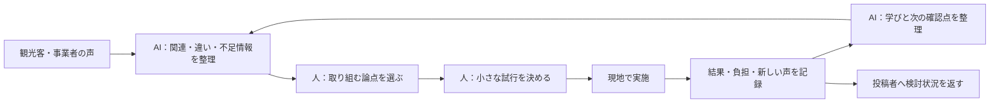

# MIURA LOOP：地域の声から観光施策を生み続ける仕組み

更新日：2026-10-29  
原案：[new_idea.md](new_idea.md)  
前提：11月20日提出／チーム3人／実装担当1人／追加の現地ヒアリングは不可

## 1. 企画の中心

> **地域の声を、次に試せる観光施策へ。**

MIURA LOOPは、三浦市の観光客・事業者の声を集め、その関係や違いを整理し、人が小さな改善策を決め、実施結果を次の改善につなげるAI Webアプリである。

三浦の観光課題は、交通、営業時間、人手、需要、情報、季節性などが絡み合う。一つのアプリが、その全てを直接解消することは想定しない。アプリが担うのは、**大きな課題を、現場の具体的な場面と、次に動ける取り組みへつなぐ作業**である。

対象は、滞在・周遊・消費・泊食分離など複数の課題。特定の観光施策を製品の前提に固定しない。開発範囲は、どの課題にも共通する次の流れに絞る。

**声を集める → つながりを見つける → 取り組む論点を決める → 小さく試す → 結果と新しい声を戻す**

AIは、声の整理、異なる立場の情報の照合、足りない情報の提示、過去の取り組みの検索、検証記録の作成を支援する。取り組む課題、施策、参加、予算、実施可否は人が決める。

### コンペでの説明案

> 三浦市の観光課題は、一度の施策で解決し切れるものではありません。私たちは、観光客の希望と事業者の事情をつなぎ、地域が小さな施策を継続して生み出し、改善できる仕組みを作ります。現場の声が何の検討につながり、実施後に何が分かったのかまで記録し、次の判断に使えるようにします。

## 2. この方向性の評価

**企画として成立する方向である。勝負どころは、声が次の判断や行動へ変わる部分を、具体的な操作として実現できるか。**

「課題が大きいから基盤を作る」だけでは、基盤の必要性までは説明できない。解く対象を、次のように置く。

> 異なる立場から出てくる声を、取り組める論点と実施条件に整理し、小さな試行と、その後の判断につなぐ際の負担を減らす。

この負担が三浦の現場でどの程度あるかは、追加ヒアリングができないため未確認である。ただし、関係者の協働・継続的な情報収集・実施・評価を支えるという問題設定には、観光地経営との接点がある。観光庁はDMOの基礎的役割として、継続的なデータ収集・分析、戦略と取り組みの調整、多様な関係者との体制・合意形成を挙げている。[観光庁・DMOとは](https://www.mlit.go.jp/kankocho/seisaku_seido/dmo/dmotoha.html)

三浦市にその機能が存在しないとは説明しない。2021年の市の観光振興ビジョンにも、官民連携とKPI評価・PDCAの方針がある。本案は、地域の既存の活動を支える道具として提案する。[三浦市観光振興ビジョン・冊子27ページ](https://www.city.miura.kanagawa.jp/material/files/group/27/kankoushinnkouvision.pdf)

| 評価軸 | この方向で狙う価値 | 審査で示す証拠 |
| --- | --- | --- |
| ビジネス価値 | 地域の声を検討・実施につなぐ準備と調整を進めやすくする | 声から取り組みを作る一連の操作、作業時間・品質の比較、運用の分担 |
| アイデアの独創性 | 観光客の希望と事業者の制約・協力余地をつなぎ、継続的な改善へ戻す | 複数の立場の声から、論点と試行条件が変わるデモ |
| AI活用の深度 | 書き方の違う声、相反する声、過去の実施記録を照合する | 出典付きの整理、誤ったまとめの修正、条件に合う過去記録の検索 |
| 使いやすさ | 投稿者は短く入力し、調整担当者は検討に必要な情報を確認できる | 短い投稿、編集可能なAI整理、分かりやすい状態表示 |
| 完成度 | 一つの共通する流れで複数の観光課題を扱う | 異なる題材でも同じ機能が動くこと、保存・再読込・AI失敗時の動作 |

市民・事業者の意見を集め、政策に結び付けるオンラインの取り組み自体には先行例がある。加古川市のDecidimもその一つ。本案の独創性は「意見を集めるWebサービス」という大枠だけで主張しない。[加古川市公式](https://www.city.kakogawa.lg.jp/soshikikarasagasu/kikakubu/jouhouseisakuka/ict_1/36257.html)

また、観光データとAIを使う分析・計画策定支援にも既存サービスがある。MIURA LOOPでは、**観光の現場で、異なる立場の声を条件付きの小さな試行へ変え、その結果を再利用する体験**を作り込む。[日本観光振興協会・デジプラの支援発表](https://nihon-kankou.or.jp/home/userfiles/files/autoupload/2026/02/1770956997.pdf)

## 3. 仕組みの全体像

最初の投稿も、施策の実施後の感想も、同じ「声」として扱える。施策が増えるほど、どんな条件で取り組み、何が分かったかが蓄積する。

循環を成立させるため、次の3種類を集める。

- **困った・できなかったこと**：旅行者の不便、事業者の障害。
- **できる・協力できること**：受入可能な曜日、既存資源、協力できる範囲。
- **うまくいったこと**：満足した体験、役立った案内、続けたい取り組み。

不満に加え、地域にある可能性と、すでに成立している工夫も材料にする。

## 4. 声を集める入口

### 観光客向け

必須入力は「今回、良かったこと・困ったこと・できたらよかったこと」の短い自由記述を中心にする。場所、日時、何をしていたかは選択・任意入力とする。個人の属性を多数聞くアンケートは初期範囲にしない。

投稿例：

- 「夕方もう少し過ごしたかったが、何ができるか分からなかった」
- 「マグロを食べた後の路地歩きが楽しかった」
- 「興味のある体験が、個人でも参加できるか分からなかった」

いずれも説明用の架空例。実際の投稿と区別して表示する。

入口は、将来的には店・宿・案内所のQR、既存アンケートからのリンク、旅行後の案内等を想定する。掲示・配信・連携の合意は未獲得であり、コンペ中の利用者獲得の前提にはしない。

### 事業者向け

「最近困ったこと」「この条件ならできること」「小さく試してみたいこと」を、一言でも残せるフォームを用意する。旅行者の声を事業者の実情として推測することはしない。

投稿例：

- 「夜の問い合わせはあるが、毎日の延長営業は難しい」
- 「前日までに数が分かれば、少人数でも対応を検討できる」
- 「平日の午後なら受入余地がある」

これらも架空例。自己申告と確認済みの受入条件は分ける。

### 既存情報からの入力

調整担当者が、公開口コミの短い手動要約、既存ヒアリング、会議メモ、公開資料等を出典付きで登録できるようにする。参加者全員に新しい投稿習慣を求めない。

ただし、次の区分を保持する。

| 入力元 | 分かること | そのまま断定できないこと |
| --- | --- | --- |
| 観光客の直接投稿 | 本人が述べた体験・希望 | 観光客全体の需要や客観的な供給状況 |
| 事業者の直接投稿 | 本人が述べた負担・条件・意思 | 他の事業者の事情、受入合意の成立 |
| 公開口コミ | 投稿されていた感想・経験 | 現在の営業情報、事業者の内部事情 |
| 公式情報・公開発言 | 公開された取り組み・条件・発言 | 未公開の運用実態、現在の余力 |
| 模擬投稿 | 動作・操作を確かめる材料 | 三浦で実際に発生した事実 |

新規の投稿窓口を作ることと、投稿が集まり続けることは別の課題。後述の運用と、投稿者への状況の返し方まで用意する。

## 5. AIが声を「取り組む論点」に変える

中心機能は、**別々に届いた声を照合し、誰のどの場面に、どんなずれがあるかを整理すること**。

単語の似ている投稿をまとめるだけでは足りない。最低限、次を扱う。

| 整理する内容 | 具体例 |
| --- | --- |
| 関連する声 | 「夜も過ごしたい」と「夜の問い合わせを受ける」 |
| 条件の違い | 平日と休日、個人と団体、当日と事前予約 |
| 立場の違い | 利用したい人、提供したい人、案内する人 |
| 相反する声 | 「朝食に困った」と「朝食に困らなかった」 |
| 既にある資源 | 予約を受けている既存の体験、営業時間が合う既存店 |
| 協力の余地 | 「毎日は難しいが、特定日なら検討できる」 |
| 不足する情報 | 必要人数、告知期限、受入条件、誰が案内するか |
| 過去の取り組み | 同じ場面で試したこと、結果、条件、残った課題 |

### 課題カードの出力例

**論点名：夜間の利用希望と、提供できる条件のすり合わせ**

- 関係する声：観光客A、事業者B、宿C。それぞれの原文・出典へ戻れる。
- 分かっていること：夜の利用希望を述べた声と、条件付きの協力意思を述べた声がある。
- 原因の仮説：需要の有無に加えて、人数・予約期限・案内接点が合っていない可能性。
- 別の見方：情報を揃えても、利用希望が十分集まらない可能性もある。
- 確かめたいこと：どの条件なら受入可能か、希望者にいつ情報が届くか。
- 次の動きの候補：追加確認、既存案内の改善、特定日の小規模試行。
- 観光課題への接続：夜間の消費機会と滞在の選択肢を増やせるか。

このカードも架空例。AIが因果関係を発見・証明したと説明しない。元の声を見て、人が論点を修正・分割・採用できるようにする。

### 優先順位の決め方

声の件数、観光への影響、困りごとの深刻さ、小さく試せるか、関係者の負担、根拠の不足を並べて判断する。AIの不透明な総合点で自動決定しない。

投稿件数は、その入力データ内の件数。地域の需要量ではない。同じ人の重複投稿や同一体験の転載を考慮し、少数の重要な声も残す。

大規模投資や制度変更が必要な論点は、そのまま担当機関への相談事項として残せるようにする。小さな情報改善で解けることに無理に置き換えない。

## 6. 論点を「小さく試せる施策」にする

人が検討を進めるとき、AIは関連資料・既存施策・過去の記録を揃え、選択肢を整理する。人の提案も同じカードへ登録できる。

候補は次のように分ける。

- **今ある接点で試せること**：案内内容・タイミングの変更、問い合わせ項目の改善等。
- **関係者の確認後に試せること**：特定日・人数・場所を限定した共同の取り組み等。
- **中長期で相談すること**：交通、施設、人材など、別途の判断・資源が必要なもの。

### 施策カードの必須項目

| 項目 | 記録すること |
| --- | --- |
| 根拠 | どの声・資料・過去記録から検討したか |
| 変えたい場面 | 誰が、いつ、何をできるようにするか |
| 小さく試す内容 | 今回だけ変更する接点・条件・手順 |
| 関係者 | 実施責任者、協力が必要な相手、確認状況 |
| 規模 | 日程・場所・対象・人数・費用・作業の上限 |
| 成功・見直しの条件 | 何を観測して継続・修正・中止を判断するか |
| 記録方法 | 件数、利用結果、負担、感想を誰がどう残すか |
| 次に必要な確認 | 合意・営業条件・情報・資源の不足 |

担当者や合意がないカードは「実施準備中」とし、実施が決まったものと分ける。AIが事業者の参加を勝手に確定しない。

小さくする対象は、1回の試行の規模、期間、負担。アプリで扱える観光課題の種類は固定しない。

## 7. 仕組みを示す3つの題材

以下は製品を特定施策に固定するものではなく、**同じ仕組みが複数の課題に使えることを示す模擬ケース**。

| 題材 | 集まる声の例 | 整理する論点 | 小さな試行の例 |
| --- | --- | --- | --- |
| 夜間の滞在 | 夜も楽しみたい／毎日の延長営業は難しい／条件が合えば対応したい | 希望と、提供条件・案内の時期が合うか | 既存の選択肢について、事前の案内と利用希望の把握を限定的に試す |
| 個人客の体験参加 | 個人で参加したい／準備には最低限の人数や事前連絡が必要 | 個人客向けの参加条件が伝わっているか、希望がまとまるか | 1つの日程・体験について、条件を明示した問い合わせ方法を試す |
| 周遊の広がり | 次に何をするか迷う／平日午後なら受入余地がある | 旅行者の時間と、受入可能な場所の条件が合うか | 既存の案内接点で、時間帯に合う情報を少数に絞って試す |

いずれも、協力・実施・効果が確認された施策ではない。コンペのデモでは、声、論点、試行、結果、新しい声のつながりを操作できるようにする。

### 夜間の題材で見せる循環

1. 観光客・事業者・宿の模擬の声を入力する。
2. AIが、希望、提供側の条件、不足情報を整理する。
3. 人が「既存の案内を早めに届け、利用希望を確認する試行」を選ぶ。
4. 担当、期間、確認事項、観測方法を施策カードに記入する。
5. 模擬結果として、案内した組数、問い合わせ、利用確認、負担を入力する。
6. 新しい声として「チェックイン時に知ったが、受付期限を過ぎていた」を追加する。
7. AIが「案内接点と受付期限のずれ」を再検討の論点として提示する。
8. 人が次回の案内時期を修正するか、さらに確かめるかを決める。

最後の声だけで、利用が少ない原因を確定しない。次に何を確かめるかが具体的になることを示す。

**審査で見せたい瞬間は、新しく届いた一つの声が、既存の検討や施策の見直しにつながるところ。**

## 8. 継続するための運用

### 役割

最初の運用は、全員が頻繁にログインする設計にしない。

| 役割 | 想定する参加の仕方 |
| --- | --- |
| 観光客 | 体験の直後・旅行後に短く投稿。自分の声の受付状況を確認 |
| 事業者 | 困りごと・できる条件・結果を必要なときに投稿 |
| 調整担当者 | 声を確認し、論点の整理、関係者への確認、試行の進行を担う |
| 市・観光協会等 | 既存の検討の場で、取り組むことや継続・修正を判断 |

運営主体は市・観光協会等を候補とするが、合意は未獲得。アプリ導入に際しては「誰が受け取り、誰が決めるか」を明確にする。

### 1サイクルの運用案

- 週1回程度、調整担当者が新しい声と関連する論点を確認する。
- 既存の会議・連絡の場で、今回進める論点を少数選ぶ。
- 試行は1〜2週間などの期間・規模を定め、負担に応じて調整する。
- 終了時に、観測結果、実施者の負担、新しい声、次の判断を残す。

頻度・期間は提案であり、三浦の現行業務を示すものではない。定例会を増やすことより、既存の活動の中で使えるかを確認する。

### 投稿する意味を返す

投稿者向けに「受け付けた」「検討している」「試行につながった」「今回は保留」の状況と、伝えられる範囲の理由を表示する。

状態の確認リンク・受付番号を渡し、自動メールやSNS通知を初期必須にしない。原文・事業上の事情は確認なく公開しない。共有できる要約・進捗と、担当者が確認する記録を分ける。

「自分の声がどこにつながったか」が分かることを、継続参加の価値の一つにする。実際に投稿が継続するかは導入後の検証事項。

## 9. 11月20日までのMVP

### 4画面で共通の流れを作る

| 画面 | 主な機能 | 最低限の完成条件 |
| --- | --- | --- |
| 声を届ける | 短文投稿、立場・場所・時期、受付状況の確認 | 入力して保存でき、他者の非公開内容を見られない |
| 声を整理する | 一覧、出典・種類、AIによる関連付け、確認・修正 | 原文へ戻れ、まとめを分割・修正できる |
| 論点を検討する | 希望・制約・協力余地、不足情報、過去記録の提示 | 複数の声を根拠に論点を整理し、人が採用できる |
| 小さく試す | 施策カード、状態、結果、教訓、関連する新しい声 | 保存・再編集し、結果を次回の検討で呼び出せる |

論点一覧や施策一覧は上記画面内に収める。自由なチャットだけを入口にせず、何を確認・入力すればよいかが分かる操作を作る。

### AIの実装は3処理を中心にする

1. 声から、希望・困りごと・制約・協力余地・対象条件を構造化する。
2. 関連する声・資料・過去記録を探し、共通点・違い・不足情報を整理する。
3. 選んだ論点や結果を、施策カード・振り返りの下書きにする。

各出力に根拠のIDを持たせる。存在するIDかの確認に加え、内容が根拠と一致するかを評価する。

同じテーマでも条件の違う声を一つの需要にまとめない。原因は仮説として扱い、分からないことは残す。数値の集計、状態の管理、権限、公開可否の処理は通常のプログラムで行う。

### 最小のデータ

- Voice：本文・要約、投稿者の立場、場所・時期、出典、情報種別、公開範囲、確認状態。
- Issue：関連するVoice ID、論点、条件、異なる見方、不足情報、検討状態。
- Trial：Issue ID、実施内容、担当、協力確認、規模・期限、指標、実施状態。
- Result：Trial ID、観測値・計測方法、負担、感想、実測・模擬区分。
- Learning：元のIssue・Trial・Result、分かったこと、限界、次の確認、使える条件。

声と論点は複数同士で関連付けられるようにする。一つの投稿を一つのテーマに強制分類しない。

### 初期に作らないもの

観光客向け旅程・経路作成、予約・決済、交通予測、SNS、複雑な会議管理、音声・動画処理、口コミの大量自動収集、複数AIエージェント構成は今回の必須範囲にしない。

慣れているWeb構成、小さなデータベース、サーバー側のAI呼び出しで始める。数十件では全文検索・タグとAI整理で足りるかを先に確かめる。

審査用の編集記録はセッションごとに分離し、初期データを戻せるようにする。AI失敗時も入力を保持する。

## 10. ヒアリングができない条件での準備

### コンペ中と導入後を分ける

**コンペ中：** 公開情報と既存資料を根拠に、声を扱う仕組みを作る。新たな事業者参加や現地の試行を必須としない。

**導入後：** 主体・窓口・声の収集接点を決め、事業者の実情と利用者の反応を確かめながら運用する。

事業者の声が足りない場合は、公開された事業者インタビュー・本人の公式発信等を探す。得られなければ「事業者の条件が未確認」と示す。観光客の口コミから補って事実化しない。

### デモ用の材料

- 公開資料・口コミの短い手動要約：30〜50件程度を収集目安にする。
- 3題材それぞれに、異なる立場・条件を含む少数の模擬投稿。
- 模擬の試行・結果：完了例、保留例、情報不足の例。
- 評価用の未見ケース：20件程度。開発時の例と分ける。

公開情報も模擬投稿も、出典・種別を画面で見分けられるようにする。実データの件数を多く見せるために混ぜない。

公開口コミは、不満・好評・中立の声を扱う。前回確認した公開投稿にも、三崎での食後の散策を楽しんだ声、宿泊中の夕食・朝食に困らなかった声がある。一律に「案内が足りない」「食事ができない」と一般化しない。[三崎港の口コミ一覧](https://www.jalan.net/kankou/spt_guide000000186722/kuchikomi/)、[三崎宿の口コミ一覧](https://www.jalan.net/yad373616/kuchikomi/)

記録項目は、URL、投稿・公開日、確認日、地域、短い要約、情報種別、解釈の限界。件数から地域全体の割合は推定しない。

提供人流データは利用必須ではなく、募集要項にはダウンロード禁止の記載がある。今回の共通機能は、人流データを外部へ持ち出さずに成立させる。[募集要項](problem.md)、[既存ヒアリング](hearing.md)

## 11. 検証する価値と指標

### 提出前に確かめるもの

| 評価 | 方法 |
| --- | --- |
| 声の意味を保てるか | 希望・制約・時期・立場の異なる20ケース程度で、人が正解基準を作り採点 |
| 関連と違いを整理できるか | 言葉は似るが違う課題、表現は違うが関連する課題を含める |
| 根拠をたどれるか | 主張と元の声の対応を確認。原文にない協力意思・原因・成果の追加を失敗として記録 |
| 次に動ける記録になるか | 担当・条件・不足情報・観測方法の欠落を確認 |
| 蓄積が役立つか | 結果の記録後、新しい声や条件を入れ、関連する過去記録が呼び出されるかを確認 |
| 作業を進めやすいか | 同じ情報を使う汎用AI＋文書の作業と、時間・品質・修正負担を比較 |
| 安定して使えるか | 投稿、保存・再読込、別セッション、AI失敗、スマートフォンでの操作を確認 |

目標は重大な創作・根拠の取り違えをゼロに近づけ、必要な確認を欠かさず処理できること。評価結果は、件数と失敗例を含めて報告する。

チーム内の作業比較は代理評価であり、市職員や事業者の実際の導入効果とは区別する。汎用AIにも同じ資料と適切な指示を与えて比較する。

### 導入後に測るもの

| 段階 | 指標例 |
| --- | --- |
| 声が届く | 投稿・既存記録の取り込み数、入力負担、参加者・地域・時期の偏り |
| 検討が進む | 整理・確認にかかった時間、追加確認を行った論点、判断理由が残った割合 |
| 行動につながる | 担当と実施条件の決まった試行、着手までの日数、実施者の負担 |
| 学びが残る | 結果・限界・次の判断を記録した試行、過去記録が参照された場面 |
| 観光に変化が出る | 各施策に応じた来店・参加・購入・滞在・不便の改善等 |

**仕組みの使いやすさ・継続性と、各施策の観光への効果を二段階で測る。**

声や施策の数が増えたことだけで成功にしない。保留や中止も、理由と次の判断が残れば学びになる。観光への効果は、各施策で分母・比較方法・欠測を決めて検証する。

## 12. 11月20日までの分担と日程

| 期間 | 実装担当 | 調査担当 | 評価・資料担当 | 到達点 |
| --- | --- | --- | --- | --- |
| 10/29〜10/31 | 投稿→保存→声一覧の骨組み | 公式情報・公開発言・口コミの整理 | 3題材の模擬データ、採点基準 | 声から始まる試作 |
| 11/1〜11/5 | AI整理→論点カード→人の修正 | 出典・情報種別・反対材料の確認 | 未見評価ケースを作る | 新しい声を整理できる |
| 11/6〜11/10 | 試行カード→結果→再参照 | 足りない情報と条件の確認 | 操作テスト、デモ台本 | 改善の循環が動く |
| 11/11〜11/13 | AI・保存・表示の修正 | 根拠と公開範囲の確認 | 作業比較・AI評価を実施 | 比較結果と失敗例が揃う |
| 11/14〜11/16 | スマホ・審査用環境の確認 | 最新性・資料表現の確認 | スライド・動画・想定問答 | 提出物の初稿完成 |
| 11/17 | 新機能の追加を終了 | 出典一覧を確定 | 全体の通し確認 | 機能を固定 |
| 11/18〜11/19 | 重大不具合の修正 | 最終確認 | URL・資料・動画・コードの提出確認 | 提出完了を目指す |
| 11/20 | 必要な最終対応 | 同左 | 同左 | 正式期限 |

締切時刻と審査環境・提出ルールは正式案内で確認する。開発時間が不足した場合も「投稿→論点→試行→結果の再利用」という共通の流れを優先し、特定題材の専用機能を増やさない。

## 13. 審査で見せる順序

3分程度のデモ構成例。正式な発表・動画制限は別途確認する。

1. **0:00〜0:20：** 三浦の複数の課題と、「地域で改善を続ける」という提案を説明。
2. **0:20〜0:50：** 観光客の声と事業者の条件を入力し、AIが関連付ける。
3. **0:50〜1:20：** 原文、異なる見方、不足情報を確認し、人が論点を決める。
4. **1:20〜1:50：** 規模・担当・期間・指標のある小さな試行を作る。
5. **1:50〜2:20：** 模擬の実施結果と新しい声を追加し、論点・次回の検討が変わる。
6. **2:20〜2:40：** 別題材も同じ仕組みで扱えることを示す。
7. **2:40〜3:00：** 評価結果、運営の分担、導入後に確かめることを示す。

公開口コミと模擬の事業者投稿を、同じ実証データとして説明しない。現地で施策を実施していない場合は、その区分を明示する。

アピール資料は、次の主張で揃える。

> 三浦の観光課題に対し、地域の声を継続して集め、関係者が小さく試し、結果から次の改善を生み出す能力を支える。

ビジネス価値は、整理・調整・検証の作業と、各試行の観光への接続で示す。AIの価値は、異なる声と過去の記録がつながる動作で示す。完成度は、投稿から次の改善まで審査員が操作できることで示す。

## 14. 直近の着手

- **実装担当：** 短い投稿フォームと声一覧、論点カードの保存を先に作る。
- **調査担当：** 旅行者の感想と事業者本人の公開発言を分け、出典付きの材料を揃える。
- **評価・資料担当：** 3題材の模擬の声を作り、取り違えてはいけない条件・立場・根拠を採点基準にする。
- **3人共通：** 「誰が受け取り、誰が決め、どう小さく試し、結果をどう戻すか」を1枚にする。

仕組みの運営主体、現場の必要性、継続参加、実際の観光効果は、導入に向けて確認が必要。提出までは、その確認に進める完成品と、根拠を保って判断を進められることの評価を揃える。